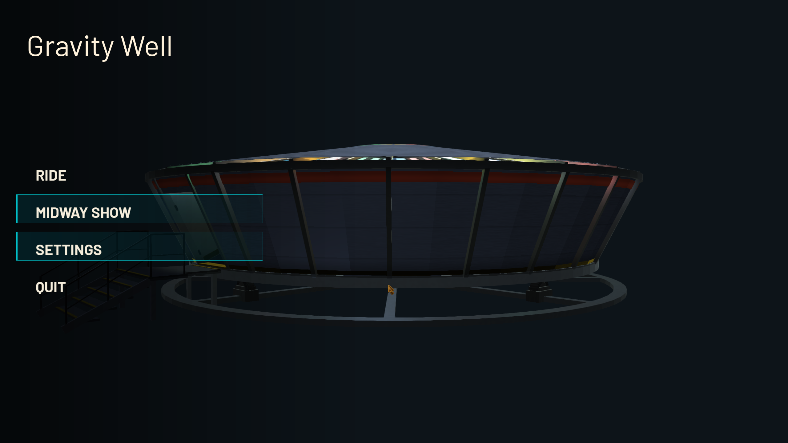
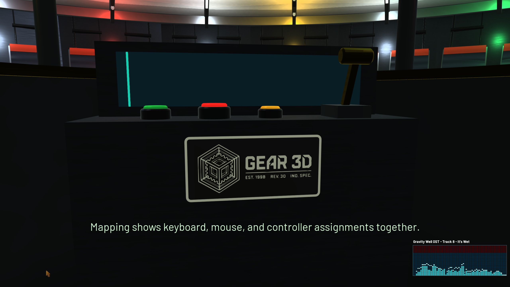
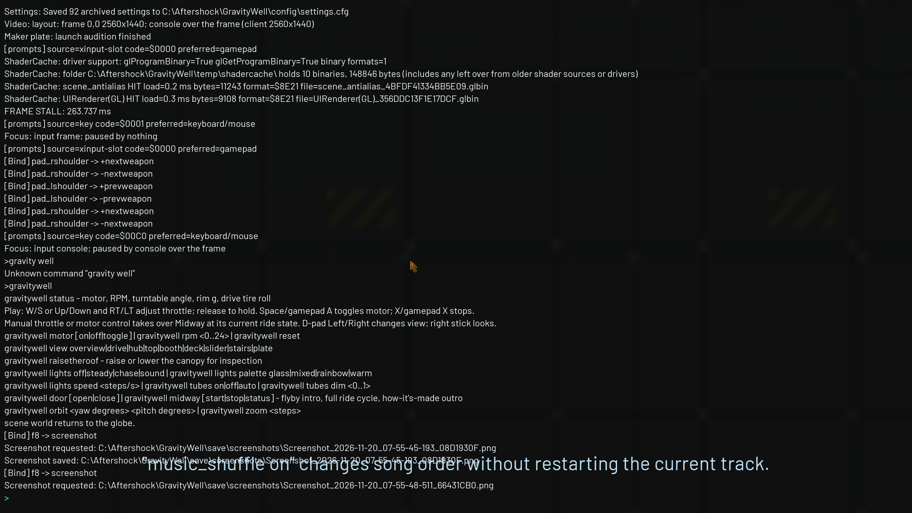
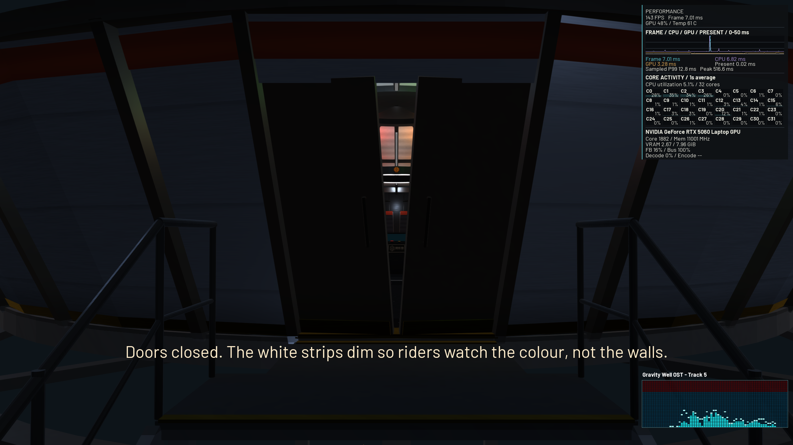
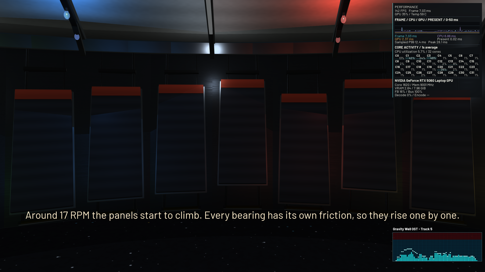
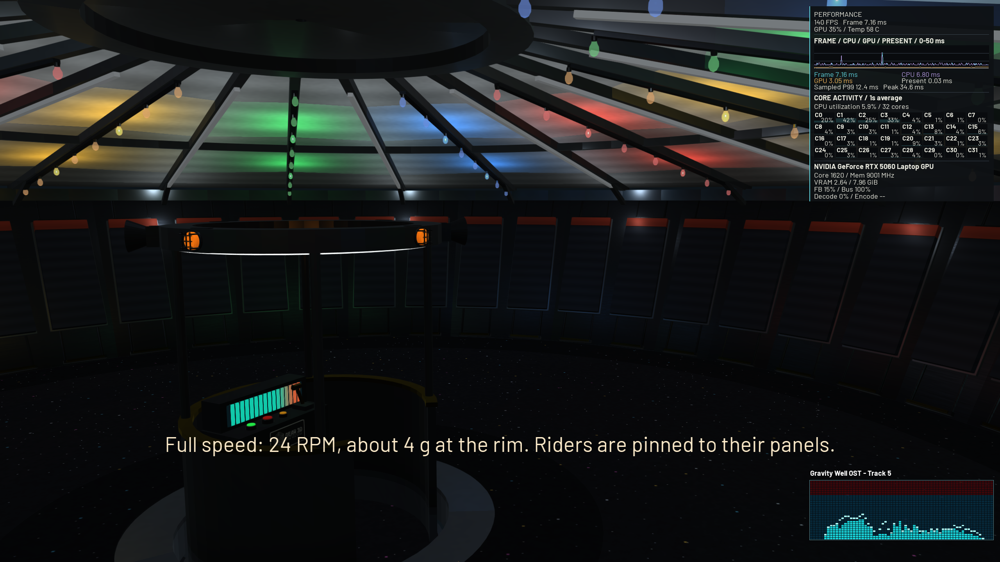
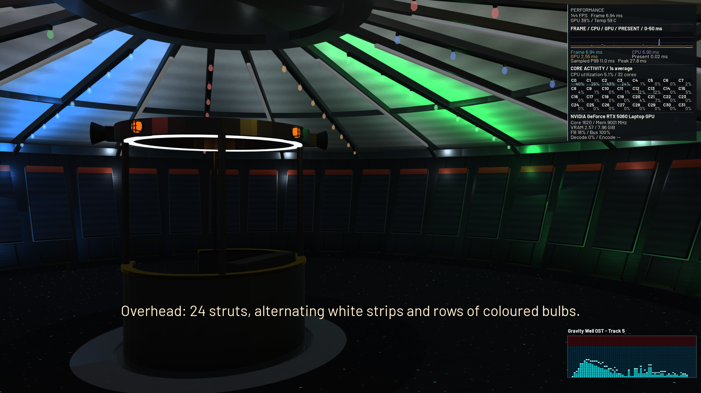

# Gear3D Desktoys

**Bring the midway to your desktop.**

Interactive 3D toys powered by Gear3D. First through the gate: **Gravity Well**.

[Downloads & release notes](https://github.com/thisoldcpu/Gear3D-Desktoys/releases) · [Controls](#take-the-controls) · [Help & feedback](#help--feedback)

## Meet Gravity Well

Gravity Well is an interactive 3D carnival ride with a working drive, sliding wall panels, changing lights, and a soundtrack to match. Take the controls, watch the Midway Show, or spend an unreasonable amount of time inspecting the machinery.

Gravity is doing most of the work. It would like some credit.

## Download the demo

**The first public download is coming soon.** Builds and their release notes will appear on the [Releases page](https://github.com/thisoldcpu/Gear3D-Desktoys/releases).

The current demo is for **Windows** and consists of **one executable**. Download the EXE directly, or extract it from the ZIP or RAR download, then run `Gear3D.exe`. It creates any missing folders automatically. Check that release's notes for requirements and known issues.

<!-- Before release: replace the coming-soon text with the actual release link,
version, download filename, download size, and verified system requirements. -->

## Pick your kind of fun

| Main menu | What it does |
| --- | --- |
| **Ride** | Hand the ride over to you. Adjust the throttle, operate the motor, and explore the camera views. |
| **Midway Show** | Watch a five-minute presentation: an opening flyby, a complete ride cycle, and a behind-the-scenes finale. |
| **Settings** | Adjust display, sound, and input preferences. |
| **Quit** | Return to your significantly less interesting desktop. |

### Make yourself comfortable

Open **Settings** to find Graphics, Sound, Controls, and Mapping. The menus work with mouse, keyboard, and controller.

Use the arrow keys or controller D-pad to move between items; **Enter / A** selects, and **Escape / B** backs out. **Tab / Shift+Tab** also moves between keyboard-focusable controls.

<!-- Uncomment when the image is added:

-->

<!-- Uncomment when the image is added:

-->

## Take the controls

**Keyboard, mouse, and controller controls are enabled.** You can watch the show or operate the ride yourself.

| Action | Keyboard / mouse | Controller (Xbox button names) |
| --- | --- | --- |
| Raise the throttle setting | Hold **W** or **Up** | Hold **RT** |
| Lower the throttle setting | Hold **S** or **Down** | Hold **LT** |
| Toggle the motor | **Space** | **A** |
| Switch the motor off | **X** | **X** |
| Change camera view | **1–9** | **D-pad Left / Right** |
| Look around | Hold the **right mouse button** and move the mouse | **Right stick** |
| Open or close the menu | **Escape** | **Start / Menu** |

Releasing the throttle controls holds your chosen setting. Switching the motor off lets the ride coast down.

Using the throttle or motor controls during the Midway Show hands the current ride state over to you. The show does not rewind to where it started.

### Steam and controllers

Steam support is optional. When Steam integration is available, controller prompts can use the matching Steam Input button icons. You can also use keyboard, mouse, or an XInput-compatible controller without Steam.

For input preferences, visit **Settings → Controls**. **Settings → Mapping** shows the general action bindings; the ride-specific controls above are listed here for quick reference.

### A little more control

Open the in-game console and enter `gravitywell` - **one word** - to list the ride commands. You can inspect the ride status, choose a camera view, change the lighting, raise the roof, or start and stop the Midway Show.

Show the console help screen

## The Midway Show

Five minutes from arrival to the inner workings: a one-minute flyby, a three-minute ride cycle, and a one-minute behind-the-scenes finale. The machinery has prepared a presentation.

Here are four moments from the ride cycle.

### Doors closed. Lights down.

The doors close and the white strips dim, giving the coloured lighting its turn.

### The panels have other plans

As the ride gains speed, the wall panels begin to climb. Each bearing has its own friction, so they rise individually.

### Up to speed

The show reaches 24 RPM, with approximately 4 g at the rim. Your chair is welcome to remain stationary.

### Let there be considerably more colour

Chase patterns, changing palettes, and sound-reactive lighting put the overhead bulbs to work. The show finishes with a look at the ride's construction.

## Help & feedback

Found something that behaves suspiciously unlike a carnival ride? [Report a problem](https://github.com/thisoldcpu/Gear3D-Desktoys/issues/new). Suggestions and questions are welcome too.

A useful report includes:

- The demo version and your Windows version.
- Your graphics card and, for input problems, your controller model.
- What you were doing, what you expected, and what happened.
- A screenshot or short clip, if it helps explain the problem.

Press **F8** to save a screenshot in the demo's `save/screenshots` folder. For startup or rendering problems, include the relevant message from `Gear3D.log` in the demo folder.

[Browse existing reports](https://github.com/thisoldcpu/Gear3D-Desktoys/issues) · [Check releases and known issues](https://github.com/thisoldcpu/Gear3D-Desktoys/releases)

---

**Gear3D Desktoys** by **ThisOldCPU**. Gravity Well is the first one through the gate.
